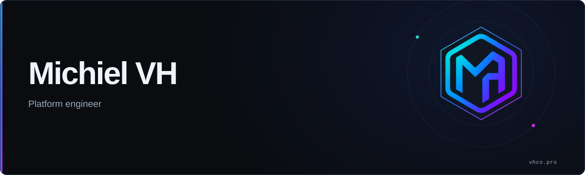
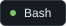

<picture>
  <source media="(prefers-color-scheme: light)" srcset="img/personal-banner-light.svg">
  
</picture>

### About me

Usually somewhere between a codebase and a Kubernetes cluster.

### My arsenal

  <picture>
    <source media="(prefers-color-scheme: light)" srcset="img/go-light.svg">
    
  </picture>
  <picture>
    <source media="(prefers-color-scheme: light)" srcset="img/typescript-light.svg">
    
  </picture>
  <picture>
    <source media="(prefers-color-scheme: light)" srcset="img/bash-light.svg">
    
  </picture>
  <picture>
    <source media="(prefers-color-scheme: light)" srcset="img/python-light.svg">
    
  </picture>
  <picture>
    <source media="(prefers-color-scheme: light)" srcset="img/powershell-light.svg">
    
  </picture>
  <picture>
    <source media="(prefers-color-scheme: light)" srcset="img/terraform-light.svg">
    
  </picture>
  <picture>
    <source media="(prefers-color-scheme: light)" srcset="img/kubernetes-light.svg">
    
  </picture>

### Official website

  <a href="https://vhco.pro">
    <picture>
      <source media="(prefers-color-scheme: light)" srcset="img/website-light.svg">
      
    </picture>
  </a>

---
### 📜 Certifications

| Title | Description |
|--------|-------------|
|  | Kubernetes and Cloud Native Associate |
|  | Kubernetes and Cloud Native Security Associate |
|  | Certified Kubernetes Administrator |
|  | Certified Kubernetes Application Developer |
|  | Certified GitHub Actions Professional |

<!-- ### Badges

 -->

### Stats

  

<!-- check all themes at: https://github.com/anuraghazra/github-readme-stats/blob/master/themes/README.md 

find more logos at: https://logosear.ch/search.html?q=
-->
